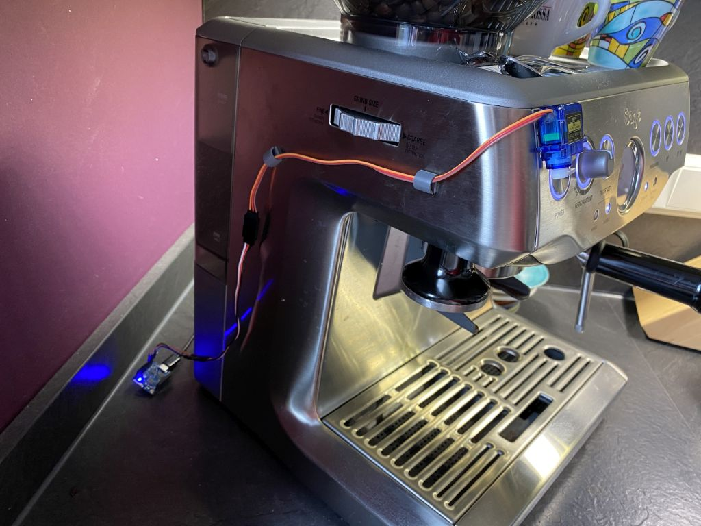

# MrCoffee
The DIY IOT coffee buddy


## Hardware

- WEMOS D1 mini pro (ESP8266)
- Servo SG90

## Assembly

- I used double sided tape to attach the servo.
- The cable clips are 3D printed and also taped at the machine.
- A 3D printed case for the wemos is in work.

## How to set up the hardware

1.  **Connect the Servo:**
    *   Connect the SG90 servo to the WEMOS D1 mini pro.
        *   Servo VCC (red wire) to WEMOS 5V pin.
        *   Servo GND (brown/black wire) to WEMOS GND pin.
        *   Servo Signal (orange/yellow wire) to WEMOS D4 pin (GPIO2). This is specified in the `myservo.attach(2);` line in the `src/MrCoffee.ino` code.
2.  **Mount the Servo:**
    *   Physically mount the servo in a position where it can interact with the coffee machine's power button or switch. The method of attachment will depend on your specific coffee machine (e.g., using double-sided tape, custom bracket).
3.  **Power the WEMOS D1 mini pro:**
    *   Connect the WEMOS D1 mini pro to a USB power source.

## How to use the code

1.  **Prerequisites:**
    *   Install the Arduino IDE (https://www.arduino.cc/en/software).
    *   Install the ESP8266 board package for the Arduino IDE. You can find instructions here: [https://github.com/esp8266/Arduino#installing-with-boards-manager](https://github.com/esp8266/Arduino#installing-with-boards-manager)
    *   Install the following Arduino libraries:
        *   `ESP8266WiFi`
        *   `WiFiClient`
        *   `ESP8266WebServer`
        *   `ESP8266mDNS`
        *   `Servo` (the version for ESP8266)
        You can usually install these from the Arduino IDE's Library Manager (Sketch > Include Library > Manage Libraries...).
2.  **Configure WiFi Credentials:**
    *   Open the `src/MrCoffee.ino` file.
    *   Modify the following lines with your WiFi network's SSID and password:
        ```cpp
        #define STASSID "YOURSSID" 
        #define STAPSK  "WIFIPASSWORD"
        ```
        Replace `"YOURSSID"` with your WiFi name and `"WIFIPASSWORD"` with your WiFi password.
3.  **Upload the Code:**
    *   In the Arduino IDE, select the correct board (WEMOS D1 R2 & mini or a compatible ESP8266 board).
    *   Select the correct COM port.
    *   Click the "Upload" button.
4.  **Access the Web Interface:**
    *   Once the code is uploaded and the ESP8266 connects to your WiFi, open the Arduino IDE's Serial Monitor (Tools > Serial Monitor) and set the baud rate to 115200.
    *   The ESP8266 will print its IP address to the Serial Monitor (e.g., `IP address: 192.168.1.100`).
    *   Open a web browser on a device connected to the same WiFi network and navigate to the IP address shown in the Serial Monitor (e.g., `http://192.168.1.100`).
    *   Alternatively, you should be able to access it via `http://esp8266.local` if mDNS starts correctly.
5.  **Control Mr. Coffee:**
    *   The web page will display "ON / OFF", "UP", and "DOWN" buttons.
        *   **ON / OFF:** Toggles the coffee machine's power by moving the servo to predefined positions.
        *   **UP / DOWN:** Allows fine-tuning of the servo's position. This might be useful for initial calibration or if the ON/OFF positions need slight adjustments.

## Features

- Turn on the machine
- Web UI / interface
- nothing more... 


See demo on YouTube:

<a href="http://www.youtube.com/watch?feature=player_embedded&v=F-EEDVyxm8g" target="_blank"></a>


## Maybe Future Features (normally they will be never implemented)

 - Time based turn on (this is currently done with an external FHEM who uses the web interface)
 - Light sensor to detect if the machine is already turned on.
 


